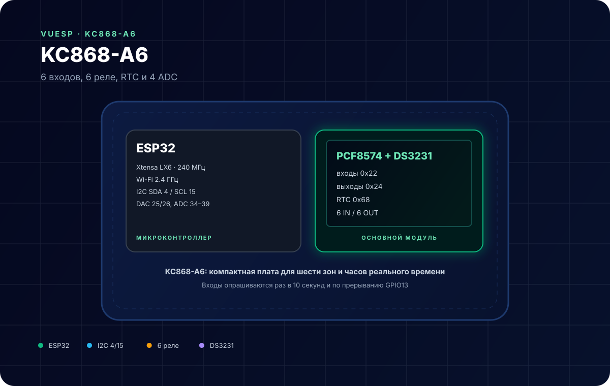
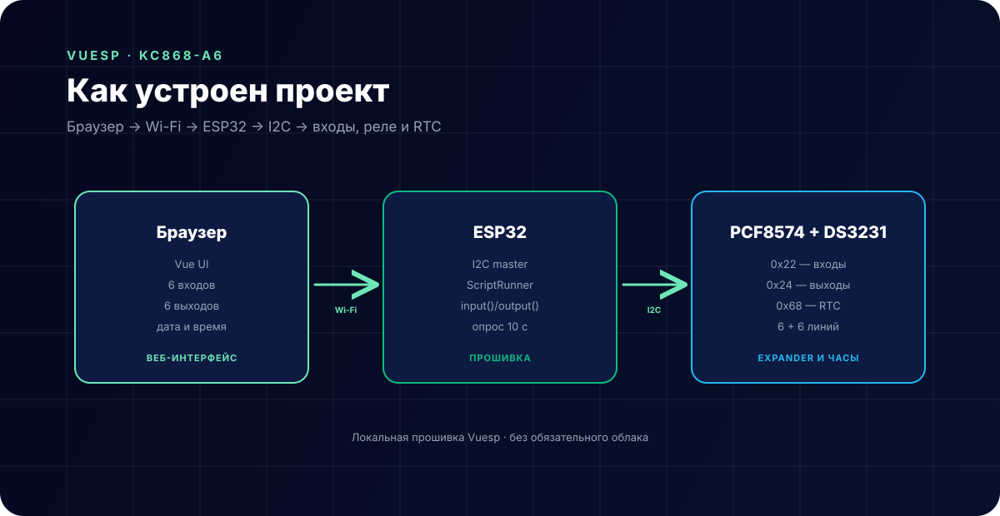

# KC868-A6 — 6 входов, 6 реле, RTC



**Коротко:** `vuesp.kc868-a6` — прошивка Vuesp **5.0.14** для платы **KinCony KC868-A6** на ESP32. Шесть оптоизолированных входов и шесть реле подключены через PCF8574 по I2C, часы реального времени DS3231 хранят дату и время, плюс 4 ADC и 2 DAC на свободных GPIO. Web UI — **4.1.2** на текущем шаблоне Vuesp. RS485 используется для Modbus RTU slave/master.

## Что это за устройство

KC868-A6 — компактная плата автоматизации:

- ESP32 с Wi-Fi 2.4 ГГц;
- 6 входов через PCF8574 `0x22`;
- 6 реле через PCF8574 `0x24`;
- RTC **DS3231** `0x68` с резервной батареей;
- 4 аналоговых входа (`GPIO36`, `39`, `34`, `35`);
- 2 ЦАП (`GPIO26` — DAC1, `GPIO25` — DAC2);
- клеммы для OneWire-датчика (`GPIO32`) и сухого контакта (`GPIO33`);
- **RS485** на MAX13487EESA: RX `GPIO14`, TX `GPIO27`, автоматическое направление;
- **RS232** на SP3232EEN: RX `GPIO16`, TX `GPIO17`;
- SPI-интерфейс для **LoRa SX1278** / **nRF24L01**: CS5, SCK18, MISO19, MOSI23, LoRa RST21/DIO0 2, nRF CE22;
- расширение UART на `GPIO13` (RXD) / `GPIO12` (TXD).

Входы читаются раз в 10 секунд и дополнительно по прерыванию `GPIO13`. Реле пишутся сразу после изменения.

## Характеристики

| Параметр | Значение |
| --- | --- |
| Микроконтроллер | ESP32 (Xtensa LX6, 240 МГц) |
| Входы | 6, PCF8574 `0x22` |
| Выходы | 6 реле, PCF8574 `0x24` |
| RTC | DS3231, адрес `0x68` |
| I2C | SDA GPIO4, SCL GPIO15 |
| ADC | GPIO36, 39, 34, 35 |
| DAC | GPIO26 (DAC1), GPIO25 (DAC2) |
| RS485 | MAX13487EESA, RX14/TX27, автонаправление |
| RS232 | SP3232EEN, RX16/TX17 |
| SPI | LoRa SX1278 / nRF24L01, CS5/SCK18/MISO19/MOSI23 |
| Wi-Fi | 802.11 b/g/n, 2.4 ГГц |
| Среда | PlatformIO + Arduino |

## Распиновка

### Основные линии

| Сигнал | GPIO | Примечание |
| --- | --- | --- |
| SDA | 4 | I2C |
| SCL | 15 | I2C |
| RTC SDA/SCL | 4 / 15 | DS3231 `0x68` |
| Входы IN1–IN6 | — | PCF8574 `0x22`, биты 0–5 |
| Реле OUT1–OUT6 | — | PCF8574 `0x24`, биты 0–5 |

### GPIO и интерфейсы

| GPIO | Назначение | Примечание |
| --- | --- | --- |
| 4 / 15 | I2C SDA / SCL | PCF8574 и DS3231 |
| 36, 39, 34, 35 | ADC1–ADC4 | аналоговые входы |
| 26 | DAC1 | аналоговый выход 1 |
| 25 | DAC2 | аналоговый выход 2 |
| 32 | OneWire | HT1, DS18B20/DHT |
| 33 | вход/OneWire | HT2, сухой контакт |
| 13 / 12 | расширение UART: RXD / TXD | на плате также используется как вход с прерыванием |
| 14 / 27 | RS485: RXD / TXD | MAX13487EESA, автоматическое направление |
| 16 / 17 | RS232: RXD / TXD | SP3232EEN |
| 5 | SPI CS | LoRa SX1278 / nRF24L01 |
| 18 | SPI SCK | LoRa / nRF24L01 |
| 19 | SPI MISO | LoRa / nRF24L01 |
| 23 | SPI MOSI | LoRa / nRF24L01 |
| 21 | LoRa RST | SX1278 |
| 2 | LoRa DIO0 | SX1278 |
| 22 | nRF24 CE | nRF24L01 |

## Схема подключения

| Клемма | Назначение |
| --- | --- |
| IN1…IN6 + COM | сухие контакты, кнопки, датчики |
| OUT1…OUT6 | реле, нагрузка через внешнее питание |
| HT1 | DS18B20 (данные + питание + GND) |
| HT2 | сухой контакт |
| AI1…AI4 | аналоговые датчики 0–3.3 В |
| 12/24 В | питание платы |

> **Важно.** Выходы реле **активны низким уровнем**: в dashboard бит `1` означает «выключено», поэтому формулы инвертированы. Учитывайте это в ScriptRunner.

## Как устроен проект



- `src/config/ConfigStore.*` — атомарное хранение настроек устройства и портов в `/tmp/config.bin`;
- `src/diag/` — лог загрузки и loop-метрики;
- `src/device/device.cpp` — PCF8574, DS3231, обработчики ScriptRunner и опрос входов;
- `src/gpio/gpio.cpp` — порты ESP32, OneWire, ADC/DAC;
- `src/const/protocol.h` — протокол и `Device` с `input`, `output`, `now`;
- `src/const/protocol.generated.h`, `vue/src/generated/protocol.ts` — генерируются из `protocol.h`;
- `src/modbus/` — Modbus RTU slave/master, профиль устройств, raw-тест и запись в точки;
- `src/rs232/` — UART2 и веб-терминал;
- `vue/json/dashboard.json` — плитки 6 входов, 6 реле, ADC/DAC и RTC.

Логика команд устройства:

| `command` | Действие |
| --- | --- |
| `1` | записать `device.now` в DS3231 |
| `2` | записать `device.output` в PCF8574 |
| `4` | сохранить конфигурацию в LittleFS |
| другое | перечитать входы, выходы и время |

## ScriptRunner

Прошивка регистрирует функции:

| Функция | Аргументы | Назначение |
| --- | --- | --- |
| `input(pin)` | `1…6` | прочитать вход: `0` — активен, `1` — нет |
| `output(pin, value)` | `0…5`, `0/1` | записать бит реле: `1` — выключено, `0` — включено |
| `var(id)` | id переменной | прочитать live-значение переменной |
| `var(id, value)` | id и значение | изменить переменную и записать её точку |
| `modbus(device, point)` | id или адрес устройства; id или адрес точки | прочитать точку напрямую |
| `modbus(device, point, value)` | id/адрес устройства, id/адрес точки, значение | записать точку напрямую |
| `fade(gpio, value, time)` | gpio, целевое значение, время | плавно изменить выход |
| `udp(deviceId, text)` | id устройства и текст | отправить текст через Discovery |
| `http(method, url, ...)` | — | заготовка HTTP-запроса, возвращает `200` |

Пример:

```text
$u0=input(1);
if:!$u0;output(0,0);else;output(0,1);end;
```

Помните про инверсию: активный вход даёт `0`, а для включения реле нужно записать `0` в бит выхода. В dashboard это уже учтено формулами `(v & bit ? 0 : 1)`.

Подсказки функций и событий для редактора скриптов лежат в `vue/json/suggestions.json`. При изменении ScriptRunner файл нужно обновлять вместе с прошивкой: он даёт автодополнение и подсветку. Общие `fade()`, `udp()` и `http()` приходят из `vuesp-components`; в файле проекта остаются только `var`, `modbus`, `input`, `output` и события `port_c/port_l/port_r/modbus`.

### Примеры скриптов

Стартовый набор лежит в `vue/public/scripts.txt` и после `build-web` попадает на устройство как `/www/scripts.txt`:

| ID | Имя | Что делает |
| ---: | --- | --- |
| 0 | `boot` | пишет приветствие в лог и регистрирует `input_event` |
| 1 | `relay1` | включает реле 1 на 1 секунду и выключает |
| 2 | `relay_walk` | поочерёдно включает все 6 реле по 500 мс |
| 3 | `input_scan` | выводит в лог состояние всех 6 входов |
| 4 | `input_event` | логирует `port_c`: индекс входа, значение и счётчик |
| 5 | `relay_toggle` | переключает реле 1 коротким нажатием на IN1 |

`boot` не включает реле: скрипты 1, 2 и 5 запускаются вручную. У A6 сырая полярность PCF8574: `input()` возвращает `0` для активного входа, а `output(..., 0)` включает реле. В dashboard это уже инвертировано.

## Modbus RTU

RS485: **TX GPIO27**, **RX GPIO14**, MAX13487EESA с автоматическим направлением — отдельный DE не нужен. По умолчанию включён **slave**, адрес `1`, `9600 8N1`. Настройки и статус — на странице **`/device/modbus/`**; параметры связи хранятся в `ConfigStore`.
При подключении к другой плате проверяйте полярность **A/B** и общий **GND**. На тестовой KC868-A6 с relay-платой обмен пошёл после перестановки A/B.


### Slave: карта

| Тип | Адрес | Значение |
| --- | --- | --- |
| Coil | `0–5` | реле 1–6, `1` — включено |
| Discrete input | `0–5` | входы 1–6, `1` — активен |
| Holding / Input | `0` | маска входов |
| Holding / Input | `1` | маска реле |
| Holding / Input | `2–5` | ADC1–ADC4 |
| Holding / Input | `6–7` | DAC1–DAC2 |
| Holding / Input | `8–10` | версия прошивки major/minor/patch |
| Holding / Input | `11–12` | uptime, младшее/старшее слово |
| Holding / Input | `13` | Modbus-адрес |
| Holding / Input | `14` | индекс скорости: 0 — 4800, 1 — 9600, 2 — 19200 |
| Holding / Input | `15` | роль: 0 — off, 1 — slave, 2 — master |
| Holding / Input | `16` | последняя ошибка |
| Holding / Input | `17–18` | requests/errors |
| Holding / Input | `19–20` | Unix time RTC, младшее/старшее слово |
| Holding / Input | `21` | сырые входы PCF8574 |
| Holding / Input | `22` | сырые выходы PCF8574 |
| Holding / Input | `100–131` | динамические slave-значения |

Функции: `01`, `02`, `03`, `04`, `05`, `06`, `0F`, `10`. Coils пишут реле; holding `6–7` пишут DAC (FC `06`/`10`). Broadcast-адрес `0`: запись применяется, ответа нет.

### Slave: динамические значения

Кроме фиксированной карты можно отдать наружу произвольные значения. Новых структур протокола нет: slave-строка — это `ModbusPoint` с `device = 0xFF`, а источник хранится в `ModbusVar.source[32]` строкой пути.

- `device = 0xFF` — slave-строка: отдаёт переменную по адресу `100…131`;
- `source` — путь к значению в дереве данных устройства;
- переменная без `source` и без точки задаётся скриптом: `var('id', value)`.

Для slave-строки `fc` = `03`/`04`, `type` — `U16/S16/U32/S32/Float32`, `address` — `100…131`, `var` — переменная. Флаг `Writable` разрешает запись из внешнего master (FC `06`/`10`); запись уходит в `source`, если он доступен для записи.

Поддерживаемые пути:

| Путь | Пример | Запись |
| --- | --- | --- |
| `ports.<gpio>.<field>` | `ports.5.value` | только `.value` |
| `device.<field>` | `device.analog` | нет |
| `info.<field>` | `info.freeHeap` | нет |
| `modbus.<field>` | `modbus.lastError` | нет |
| `dallas.<rom>.<field>` | `dallas.28ff64e1e01603c8.temp` | нет |
| `vars.<id>.value` | `vars.temp1.value` | нет |

`<field>` порта — любое скалярное поле (`value`, `mode`, `count`, `pressStart` и т. д.); для Dallas — `temp` или `valid`. Массивы, объекты и строки источником быть не могут. Неизвестный путь или отсутствующая Dallas дают качество `DISABLED`/`STALE` и значение `0`; профиль из-за этого не отклоняется.

Значение можно задать и скриптом: `var('temp1', 23.5)` — переменная сразу доступна slave-строке.

Пример: `ports.5.value` → переменная `pad5` → slave holding `100`; другой master читает `100`.

UI разделён по ролям: в режиме **Slave** показываются Profile, Register map и Slave values; устройства и master-точки скрыты. В режиме **Master** показываются устройства, master-точки и Variables.

На странице Modbus блок **Slave values** показывает занятость банка. Добавление и редактирование значения используют одно окно: источник — **данные устройства** или **скрипт**. В дереве доступны `ports`, `device`, `dallas`, `info`, `modbus`; «+» показывается только у скалярных полей. Тип, decimals и unit подставляются автоматически, ID, scale и offset находятся в **Advanced**, `Writable` показывается всегда.

**Register map** строится динамически: после фиксированных строк показываются все настроенные slave-значения из draft-профиля с адресами и типами. Клик по строке открывает детали: тип, число регистров, hex-регистры текущего значения, готовый read-кадр с CRC и пример ответа. Кадр копируется одной hex-строкой; неприменённые значения видны в деталях с пометкой `not applied`.

### Master

Master опрашивает внешние RTU-устройства по профилю: до 8 устройств, 64 точек и 32 переменных. Поддерживаются `U16/S16/U32/S32/U64/S64/Float32/Float64/Bool/String/Bit/Enum/BCD`, запись в writable-точки и проверка точки из диалога. Профиль хранится в `/tmp/modbus.bin`, переменные доступны в dashboard как `vars.<id>.value`.

#### Пример: кнопка на KC управляет реле другого устройства

- relay-x2: режим **Slave**, адрес `1`, `9600 8N1`;
- KC: режим **Master**, профиль:
  - устройство `relayx2`, адрес `1`;
  - точка `relay1`, `FC 01`, адрес `0`, `Bool`, флаг `Writable`, переменная `relay1`.

Скрипт в `vue/public/scripts.txt`:

```text
0:boot:call(4);
4:relay_button:on('port_c');if:$e0 == 3;$f0=var('relay1');if:$f0;var('relay1',0);else;var('relay1',1);end;end;end;
```

`$e0 == 3` — вход IN4 (нумерация с нуля), `port_c` — клик. `var('relay1')` читает переменную, `var('relay1', 0/1)` меняет её и ставит запись в очередь master, поэтому на relay-x2 уходит `FC05` на coil `0`. В прошивке нет зашитой логики кнопки или реле: всё задаётся профилем и скриптом.

То же самое можно записать короче, числовыми адресами: `modbus(1, 0)` — устройство с адресом `1`, точка с адресом `0`; `modbus(1, 0, 1)` — записать `1`. Числовой `device` — это Modbus-адрес устройства, числовой `point` — поле `address` точки. Если у нескольких точек один адрес, используйте id.
На dashboard KC добавлена плитка **`relay-x2.1`**: она читает `vars.relay1.value`, а по клику на кнопку плитки отправляет `KEY.MODBUS` с `CMD.WRITE` на `point = 0`. То есть состояние можно менять и с плитки, и кнопкой IN4 — оба пути используют один и тот же writable-профиль.

Поля записи в `KEY.MODBUS`: `point`, `value`, `text`; результат постановки в очередь — `ok` (`1` — принято, `0` — точка не writable или не найдена).

## RS232

RS232 подключён к UART2:

- RXD — GPIO16, TXD — GPIO17, трансceiver SP3232EEN, разъём DB9;
- страница **SERIAL** (`/device/rs232/`);
- скорость 1200–115200, по умолчанию 9600 8N1; чётность none/even/odd, стоп-биты 1/2;
- терминал — общий компонент `SerialConsole` из `vuesp-components`: ASCII/HEX-вид, время, перенос, автопрокрутка, поиск с подсветкой, пауза, кадры по строке или паузе, UTF-8/CP1251, отправка текста и HEX, история, быстрые команды, счётчики RX/TX и скорость в байт/с;
- строки, начинающиеся с `VUESP:`, плата разбирает на RS232 и отвечает в тот же порт (`PING`, `INFO`, `SCAN`, `SET`), остальные данные идут прозрачно;
- настройки сохраняются в `ConfigStore`, порт автоматически открывается при старте;
- Modbus продолжает работать на отдельном UART1 (RS485, GPIO14/27), конфликта с RS232 нет.

Протокол: `KEY_RS232` (18), структура `Rs232` (280 байт). Команды: `CMD_GET`, `CMD_SET`, `CMD_WRITE`, `CMD_RESTORE`, `CMD_READ`.

## Сборка и прошивка

```bash
cd vue
npm ci
npm run protocol
npm run build-web

cd ..
~/.platformio/penv/bin/pio run
~/.platformio/penv/bin/pio run -t buildfs
```

`protocol` генерирует `src/const/protocol.generated.h`, `vue/src/generated/protocol.ts` и `vue/public/default.json` из `src/const/protocol.h`.

Прошивка: `build/esp32/firmware.bin`, FS: `build/esp32/littlefs.bin`.

`littlefs.bin` собирается из `data/`, а `data/www` очищается Vite при каждом `build-web`, поэтому в образ попадает только текущий хешированный бандл. При заливке web по файлам через `/fs` старые `assets/*` на устройстве не удаляются — их нужно удалять вручную; `littlefs.bin` заменяет FS целиком.

## Ограничения

- Шесть входов и шесть реле — фиксировано; расширение только внешними модулями на свободной I2C.
- RS485 на MAX13487EESA имеет автоматическое направление (без DE) и используется Modbus RTU; в режиме master нужен внешний slave-модуль.
- RS232 (SP3232EEN) используется веб-терминалом; SPI-интерфейс LoRa/nRF24L01 в текущей прошивке не используется, GPIO21, 2, 22, 5, 18, 19, 23 остаются свободными Vuesp-портами.
- GPIO13/GPIO12 на плате также выведены как расширение UART; в Vuesp GPIO13 настроен как вход с прерыванием.
- RTC требует установленной батареи CR1220/CR2032; без неё время сбрасывается при отключении питания.
- ADC ESP32 шумит и нелинейный; для точных измерений нужна калибровка.
- Выходы активны низким уровнем — легко получить инверсию при собственных сценариях.
- I2C-адреса `0x22`, `0x24`, `0x68` заняты; внешние модули должны использовать другие адреса.

## Источники

- [KinCony KC868-A6 — описание платы](https://www.kincony.com/esp32-home-automation-board-kc868-a6.html)
- [DS3231 datasheet](https://www.analog.com/media/en/technical-documentation/data-sheets/DS3231.pdf)
- [PCF8574 datasheet](https://www.ti.com/lit/ds/symlink/pcf8574.pdf)
- [Документация Vuesp](https://docs.vuesp.ru)
