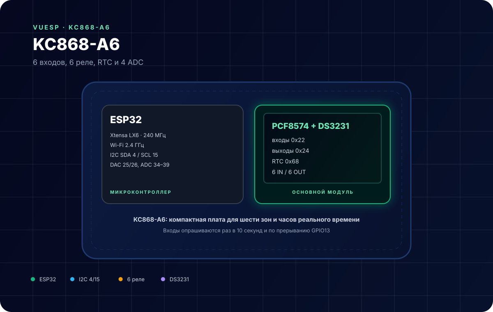
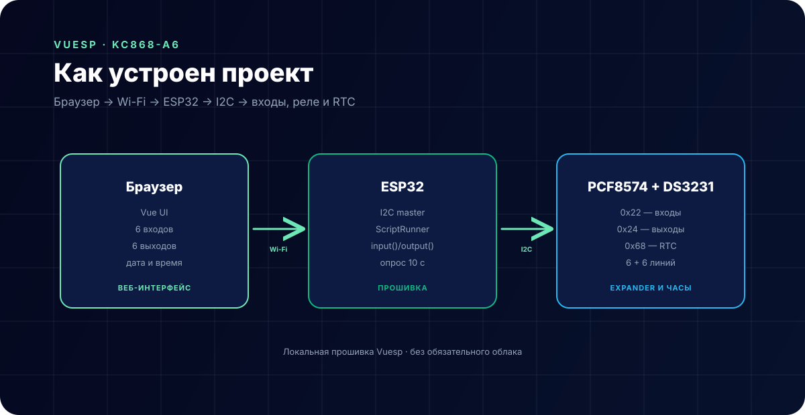

# KC868-A6 — 6 входов, 6 реле, RTC



**Коротко:** `vuesp.kc868-a6` — прошивка Vuesp для платы **KinCony KC868-A6** на ESP32. Шесть оптоизолированных входов и шесть реле подключены через PCF8574 по I2C, часы реального времени DS3231 хранят дату и время, плюс 4 ADC и 2 DAC на свободных GPIO.

## Что это за устройство

KC868-A6 — компактная плата автоматизации:

- ESP32 с Wi-Fi 2.4 ГГц;
- 6 входов через PCF8574 `0x22`;
- 6 реле через PCF8574 `0x24`;
- RTC **DS3231** `0x68` с резервной батареей;
- 4 аналоговых входа (`GPIO36`, `39`, `34`, `35`);
- 2 ЦАП (`GPIO25`, `26`);
- клеммы для OneWire-датчика (`GPIO32`) и сухого контакта (`GPIO33`);
- вход `GPIO13` с прерыванием и вход `GPIO12`.

Входы читаются раз в 10 секунд и дополнительно по прерыванию `GPIO13`. Реле пишутся сразу после изменения.

## Характеристики

| Параметр | Значение |
| --- | --- |
| Микроконтроллер | ESP32 (Xtensa LX6, 240 МГц) |
| Входы | 6, PCF8574 `0x22` |
| Выходы | 6 реле, PCF8574 `0x24` |
| RTC | DS3231, адрес `0x68` |
| I2C | SDA GPIO4, SCL GPIO15 |
| ADC | GPIO36, 39, 34, 35 |
| DAC | GPIO25, 26 |
| Wi-Fi | 802.11 b/g/n, 2.4 ГГц |
| Среда | PlatformIO + Arduino |

## Распиновка

### Основные линии

| Сигнал | GPIO | Примечание |
| --- | --- | --- |
| SDA | 4 | I2C |
| SCL | 15 | I2C |
| RTC SDA/SCL | 4 / 15 | DS3231 `0x68` |
| Входы IN1–IN6 | — | PCF8574 `0x22`, биты 0–5 |
| Реле OUT1–OUT6 | — | PCF8574 `0x24`, биты 0–5 |

### Свободные GPIO

| GPIO | Режим | Назначение |
| --- | --- | --- |
| 32 | OneWire | датчик DS18B20 (HT1) |
| 33 | вход | сухой контакт (HT2) |
| 13 | вход с подтяжкой, прерывание | кнопка/датчик |
| 12 | вход | кнопка/датчик |
| 25 | DAC | аналоговый выход 1 |
| 26 | DAC | аналоговый выход 2 |
| 36, 39, 34, 35 | ADC | аналоговые входы |

## Схема подключения

| Клемма | Назначение |
| --- | --- |
| IN1…IN6 + COM | сухие контакты, кнопки, датчики |
| OUT1…OUT6 | реле, нагрузка через внешнее питание |
| HT1 | DS18B20 (данные + питание + GND) |
| HT2 | сухой контакт |
| AI1…AI4 | аналоговые датчики 0–3.3 В |
| 12/24 В | питание платы |

> **Важно.** Выходы реле **активны низким уровнем**: в dashboard бит `1` означает «выключено», поэтому формулы инвертированы. Учитывайте это в ScriptRunner.

## Как устроен проект



- `src/device/device.cpp` — PCF8574, RTC, обработчики ScriptRunner, опрос;
- `src/gpio/gpio.cpp` — свободные GPIO, OneWire, ADC/DAC;
- `src/modbus/` — заготовка Modbus (в текущей сборке не включена);
- `src/const/struct.h` — `Device` с `input`, `output`, `now`;
- `vue/json/dashboard.json` — плитки 6 входов и 6 реле.

Логика команд устройства:

| `command` | Действие |
| --- | --- |
| `1` | записать `device.now` в DS3231 |
| `2` | записать `device.output` в PCF8574 |
| `4` | сохранить конфигурацию в LittleFS |
| другое | перечитать входы, выходы и время |

## ScriptRunner

Прошивка регистрирует две функции:

| Функция | Аргументы | Назначение |
| --- | --- | --- |
| `input(pin)` | `1…6` | прочитать вход: `0` — активен, `1` — нет |
| `output(pin, value)` | `0…5`, `0/1` | записать бит реле: `1` — выключено, `0` — включено |
| `http(...)` | — | заготовка HTTP-запроса |

Пример:

```text
$u0=input(1);
if:!$u0;output(0,0);else;output(0,1);end;
```

Помните про инверсию: активный вход даёт `0`, а для включения реле нужно записать `0` в бит выхода. В dashboard это уже учтено формулами `(v & bit ? 0 : 1)`.

## Сборка и прошивка

```bash
cd vue
npm ci
npm run build-web

cd ..
~/.platformio/penv/bin/pio run
~/.platformio/penv/bin/pio run -t buildfs
```

Прошивка: `build/esp32/firmware.bin`, FS: `build/esp32/littlefs.bin`.

## Ограничения

- Шесть входов и шесть реле — фиксировано; расширение только внешними модулями на свободной I2C.
- `setModbusSetup()` в `setupDevice()` закомментирован: Modbus-функции не работают.
- RTC требует установленной батареи CR1220/CR2032; без неё время сбрасывается при отключении питания.
- ADC ESP32 шумит и нелинейный; для точных измерений нужна калибровка.
- Выходы активны низким уровнем — легко получить инверсию при собственных сценариях.
- I2C-адреса `0x22`, `0x24`, `0x68` заняты; внешние модули должны использовать другие адреса.

## Источники

- [KinCony KC868-A6 — описание платы](https://www.kincony.com/esp32-home-automation-board-kc868-a6.html)
- [DS3231 datasheet](https://www.analog.com/media/en/technical-documentation/data-sheets/DS3231.pdf)
- [PCF8574 datasheet](https://www.ti.com/lit/ds/symlink/pcf8574.pdf)
- [Документация Vuesp](https://docs.vuesp.ru)
